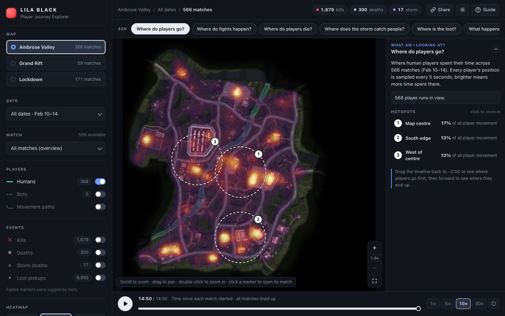
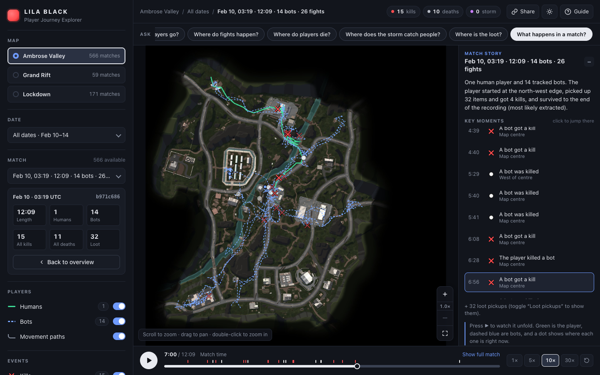
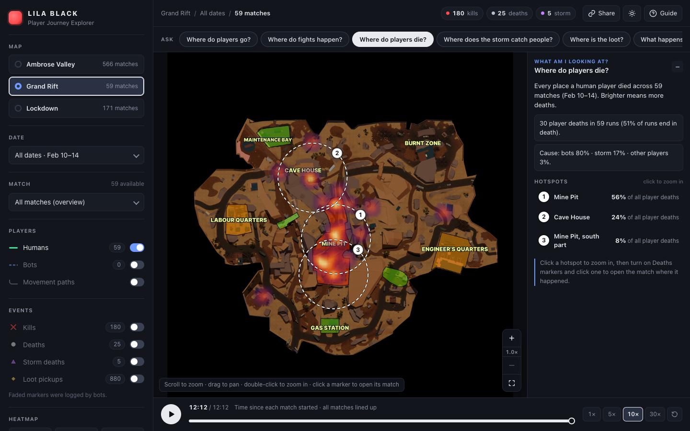
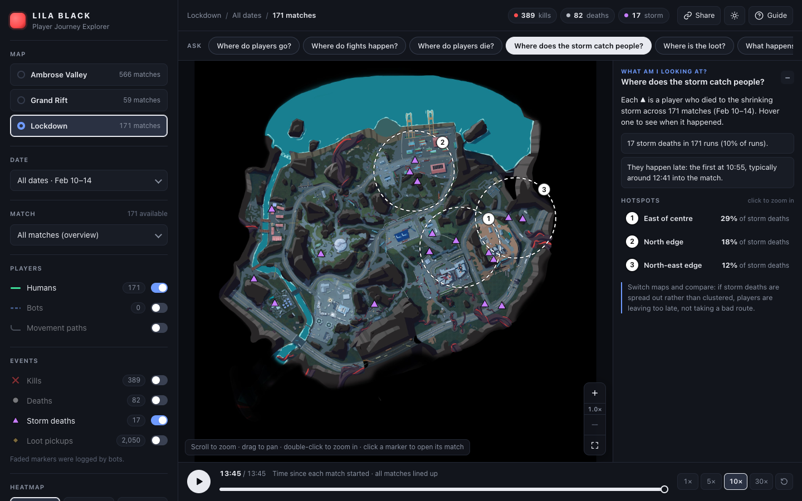
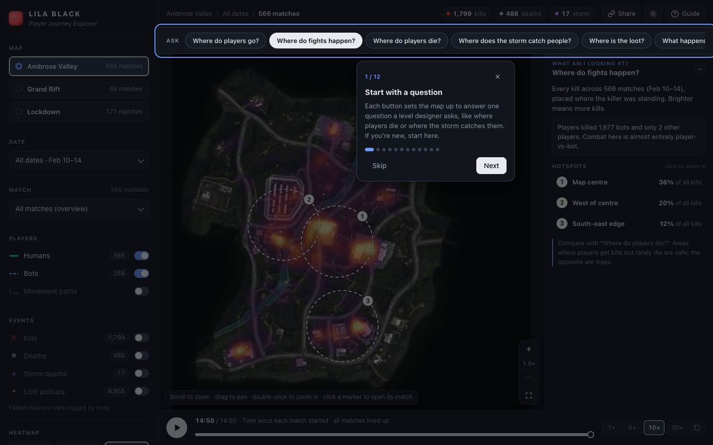
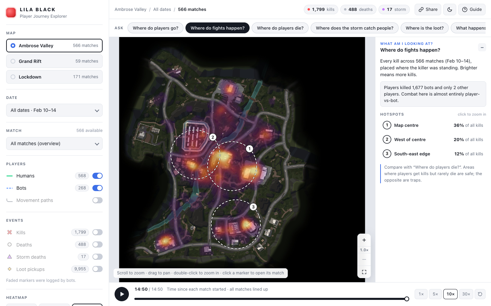
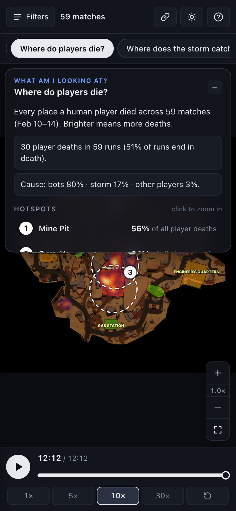

# LILA BLACK — Player Journey Explorer

A browser tool for **Level Designers** to see how players actually move, fight, loot and die on LILA BLACK's three maps. It's built from 5 days of production telemetry (Feb 10–14, 2026).

**Live tool:** LIVE_URL_HERE



## What you can do

| Feature | How |
|---|---|
| **Ask a question** | A question bar above the map answers the six things a designer asks: *Where do players go? · Where do fights happen? · Where do players die? · Where does the storm catch people? · Where is the loot? · What happens in a match?* One click sets up the right view. |
| **Explanation panel** | Says in plain words what the map shows, gives the key numbers (e.g. cause of death, storm timing), circles and numbers the **top 3 hotspots** on the map with their share (click to zoom), and suggests what to look at next. |
| **Match story** | For a single match: a one-line summary of what happened to the player, plus a clickable timeline of key moments that jumps playback and the map to that spot. |
| **Pick a map, date and match** | Sidebar. "All matches" overlays every match on the map. Pick one match to replay it. |
| **See player journeys on the minimap** | Humans = solid green lines, bots = dashed blue lines. World coordinates are mapped to the minimap ([how](ARCHITECTURE.md#coordinate-mapping-the-tricky-part)). |
| **See events as distinct markers** | ✕ kill · ● death · ▲ storm death · ◆ loot. Bot-logged events are faded. Hover any marker for details. |
| **Play back a match** | Timeline at the bottom: play/pause, scrub, 1–30× speed. Combat moments are ticked on the track. A dot marks where each player is "now". |
| **Heatmaps** | Traffic, kills, deaths, storm deaths and loot. They follow every filter, including the timeline (e.g. "deaths in the first 3 minutes"). |
| **Jump from pattern to cause** | In the aggregate view, click any marker to open the match it came from. |
| **Share a view** | Map, date, match and heatmap are kept in the URL. **Share** copies a link to exactly what you see. |
| **Zoom & pan** | +/−/fit buttons with a zoom readout, scroll or trackpad pinch, touch pinch, drag to pan, double-click to zoom in, keys `+` `−` `0`. |
| **Guided tour** | First-time visitors get a "New here?" card (top right) that walks through each part of the UI, spotlighting it. **Guide** reopens it at any time. |
| **Light / dark mode** | Toggle in the top bar. Remembers your choice and defaults to the OS setting. |
| **Mobile & tablet** | Below 900 px the filters move into a slide-in drawer, the timeline reflows, and touch gestures work (tap a marker for details). |

| Match story & playback | Where do players die? (Grand Rift) | Where does the storm catch people? (Lockdown) |
|---|---|---|
|  |  |  |

| Guided tour | Light mode | Mobile |
|---|---|---|
|  |  |  |

## Tech stack

- **Data pipeline:** Python 3.10+, pandas, pyarrow, Pillow (`pipeline/build_data.py`)
- **Frontend:** React 19, TypeScript, Vite, HTML Canvas 2D. No UI or chart libraries.
- **Hosting:** Vercel (static site). **No backend, no database, no environment variables.**

## Repo layout

```
data/player_data/        raw dataset as provided (parquet files, minimaps, README)
pipeline/build_data.py   parquet -> web/public/data/*.json (+ resized minimaps)
web/                     the React app (deployed folder)
  public/data/           generated JSON (committed, so deploying needs no Python)
  src/lib/               types, data loading, heatmap, lenses (question presets), insights (hotspots, stories)
  src/components/        Sidebar, MapView (canvas), Timeline, QuestionBar, InsightPanel, Tour, …
ARCHITECTURE.md          design decisions, data flow, coordinate mapping, trade-offs
INSIGHTS.md              three findings about the game, with evidence
```

## Run locally

```bash
# 1) (optional) rebuild the data — the generated JSON is already committed
python3 -m venv .venv && source .venv/bin/activate
pip install -r pipeline/requirements.txt
python pipeline/build_data.py          # ~6 s, prints a cleaning summary

# 2) run the app
cd web
npm install
npm run dev                            # http://localhost:5173
```

## Deploy

```bash
cd web
npx vercel --prod                      # framework: Vite, output: dist (auto-detected)
```

From the Vercel dashboard instead: import the GitHub repo and set **Root Directory = `web`**. The defaults handle the rest.

## Docs

- [ARCHITECTURE.md](ARCHITECTURE.md): stack choices, data flow, coordinate mapping, assumptions, trade-offs
- [INSIGHTS.md](INSIGHTS.md): three things the tool revealed about the maps
